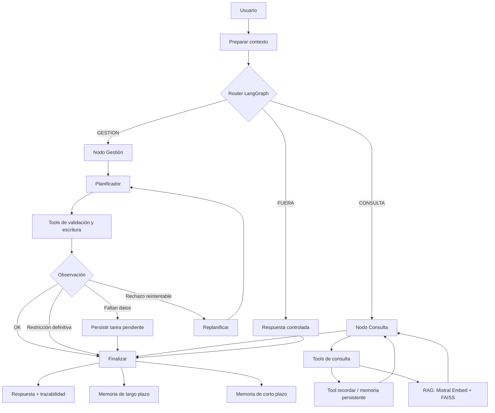

# Agente inteligente para la gestión de operativos — CSA Salud Integral SpA

Proyecto académico desarrollado para la **Evaluación Parcial N.º 2** de la asignatura
**ISY0101 — Ingeniería de Soluciones con Inteligencia Artificial**.

**Integrantes:** Leonel Gonzalez y Pablo Toro.

> CSA Salud Integral SpA se utiliza como caso organizacional de referencia. Los procedimientos
> internos, operativos y datos utilizados por el prototipo son ficticios. No se procesan datos
> clínicos, personales ni información confidencial real.

## Objetivo

Evolucionar el prototipo RAG desarrollado en la EP1 hacia un **agente funcional** capaz de
consultar conocimiento, planificar tareas, ejecutar herramientas de lectura y escritura,
mantener memoria de corto y largo plazo y adaptar su comportamiento ante condiciones cambiantes.

## Continuidad con la EP1

Se conserva la base validada en la primera evaluación:

- Mistral como LLM.
- `mistral-embed` para embeddings.
- FAISS para recuperación semántica.
- Corpus de 6 procedimientos internos ficticios + 2 fuentes externas públicas resumidas.
- Chunking `450 / 80`.
- Umbral del corpus `0.78`.
- RAG con trazabilidad.

La EP2 agrega:

- LangGraph `StateGraph` como orquestador.
- 11 herramientas LangChain.
- Plan-and-Execute.
- Replanificación.
- Memoria de corto plazo.
- Memoria persistente de largo plazo.
- Persistencia de tareas pendientes.
- Herramientas de escritura sobre un sistema simulado de operativos.
- Guardrails para IDs, datos sensibles y alcance.

## Arquitectura



La versión ampliada del diagrama está en [`docs/arquitectura.md`](docs/arquitectura.md).

## Herramientas del agente

| Tipo | Herramientas |
|---|---|
| Consulta | `buscar_procedimientos`, `buscar_normativa`, `consultar_operativo`, `listar_operativos`, `recordar` |
| Validación / razonamiento | `validar_requisitos` |
| Escritura | `crear_operativo`, `programar_operativo`, `actualizar_operativo`, `registrar_incidencia`, `guardar_nota` |

## Estructura

```text
agente-csa-ep2/
├── README.md
├── requirements.txt
├── .env.example
├── .gitignore
├── notebooks/
│   └── Agente_CSA_EP2_Final.ipynb
├── data/
│   ├── README.md
│   ├── corpus_simulado.json
│   └── operativos_iniciales.json
├── docs/
│   ├── arquitectura.md
│   └── arquitectura_orquestacion.mmd
└── evidencias/
    ├── README.md
    ├── resumen_escenarios.csv
    ├── estado_final_operativos.csv
    └── transcripciones/
        ├── E1_consulta.txt
        ├── E2a_faltan_datos.txt
        ├── E2b_continuacion.txt
        ├── E3_operativo_cerrado.txt
        ├── E4_datos_sensibles.txt
        ├── E5_fuera_alcance.txt
        └── E6_nueva_sesion.txt
```

## Requisitos

- Python 3.10 o superior, o Google Colab.
- Cuenta/API Key de Mistral AI.
- Acceso a Internet para instalar dependencias y utilizar los modelos.

Instalación local:

```bash
python -m venv .venv
# Windows
.venv\Scripts\activate

pip install -r requirements.txt
jupyter notebook
```

Luego define la credencial:

```bash
# PowerShell
$env:LLM_API_KEY="TU_API_KEY"
```

No subas la API Key al repositorio.

## Ejecución recomendada en Google Colab

1. Abre `notebooks/Agente_CSA_EP2_Final.ipynb` en Google Colab.
2. En **Secrets**, crea `LLM_API_KEY`.
3. Pega la API Key de Mistral y habilita el acceso del notebook.
4. Ejecuta las celdas de arriba hacia abajo.
5. Cuando Colab solicite acceso a Google Drive, autorízalo. El notebook utiliza Drive para
   persistir memoria y estado entre sesiones.
6. Para reproducir E1–E6 desde cero, ejecuta la celda **“Preparación de evidencias”** que reinicia
   los datos simulados, la tarea pendiente y la memoria de demostración.
7. Para una prueba real de memoria entre sesiones, no vuelvas a ejecutar esa celda antes de E6.

## Escenarios de validación

| Escenario | Comportamiento esperado |
|---|---|
| E1 | Recuperar y explicar el procedimiento de cierre mediante RAG |
| E2a | Detectar `tipo_servicio` faltante y persistir la tarea |
| E2b | Retomar la tarea, crear `OP-004` y dejarlo `Programado` |
| E3 | Rechazar modificación de `OP-002` por encontrarse `Finalizado` |
| E4 | Rechazar dato sensible, consultar normativa y replanificar de forma segura |
| E5 | Rechazar una consulta clínica fuera de alcance |
| E6 | Recuperar desde memoria el estado final de `OP-004` en una nueva instancia |

La ejecución final validada se encuentra documentada en [`evidencias/`](evidencias/).

## Resultado final de la demo

- `OP-004` creado para **Logística Pacífico SpA**.
- Fecha: **2026-12-15**.
- Servicio: **exámenes preventivos**.
- Estado: **Programado**.
- Coordinador: **Coordinador C**.
- E4 no reutiliza datos de OP-004 en acciones sobre OP-001.
- E6 recupera el estado final de OP-004 desde memoria persistente.

## Seguridad y alcance

- Los IDs `INT-XXX` corresponden a documentos; los `OP-XXX` a operativos.
- Las tools de gestión rechazan IDs que no cumplan el patrón `OP-XXX`.
- El agente no debe registrar datos personales o clínicos reales.
- Las incidencias con posibles datos sensibles son rechazadas y deben reformularse.
- La memoria semántica no se utiliza automáticamente para completar campos de escritura.
- Las consultas fuera del alcance se rechazan sin ejecutar herramientas innecesarias.

## Evidencias

Consulta:

- [`evidencias/resumen_escenarios.csv`](evidencias/resumen_escenarios.csv)
- [`evidencias/estado_final_operativos.csv`](evidencias/estado_final_operativos.csv)
- [`evidencias/transcripciones/`](evidencias/transcripciones/)

## Referencias principales

- Mistral AI — documentación de modelos, embeddings y API.
- LangChain / LangGraph — herramientas y orquestación de agentes.
- FAISS — búsqueda vectorial por similitud.
- Biblioteca del Congreso Nacional de Chile — Ley N.º 19.628.
- Ministerio de Salud / LeyChile — Decreto Supremo N.º 594.

## Nota académica

Este repositorio corresponde a un **prototipo académico**. No está diseñado para uso productivo
ni para el tratamiento de información clínica o personal real.
