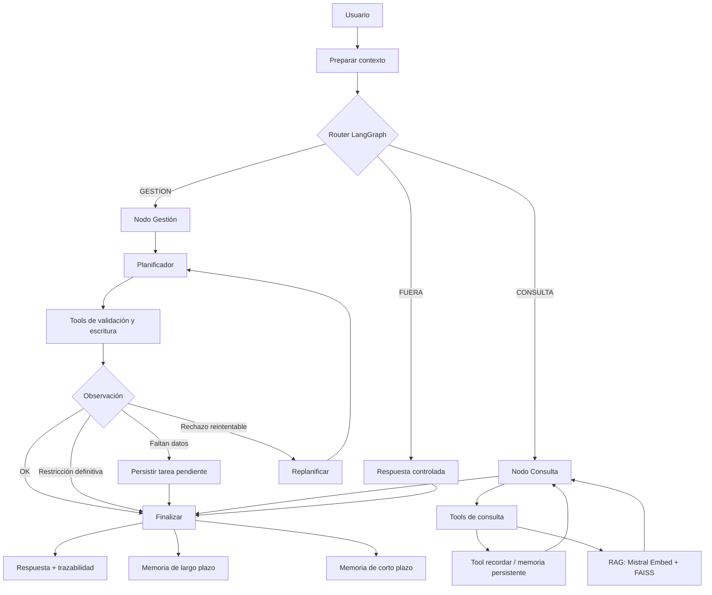

# Arquitectura y orquestación

El agente utiliza **LangGraph `StateGraph`** para representar explícitamente el flujo de ejecución.
LangChain aporta las herramientas y mensajes; Mistral se utiliza para generación, clasificación,
planificación y embeddings; FAISS soporta recuperación semántica del corpus y de la memoria persistente.

## Componentes

- **Router:** clasifica cada solicitud en `CONSULTA`, `GESTION` o `FUERA`.
- **Consulta:** ejecuta herramientas de lectura, RAG y memoria cuando corresponde.
- **Gestión:** aplica Plan-and-Execute, valida datos, ejecuta tools de escritura y replantea ante condiciones reintentables.
- **Tarea pendiente:** persiste una tarea estructurada cuando faltan datos y permite retomarla en un turno posterior.
- **Memoria de corto plazo:** conserva hasta tres turnos recientes.
- **Memoria de largo plazo:** FAISS persistente con prioridad para estados finales verificados.
- **Guardrails:** separación `INT-*` / `OP-*`, control de datos sensibles y rechazo de consultas fuera de alcance.
